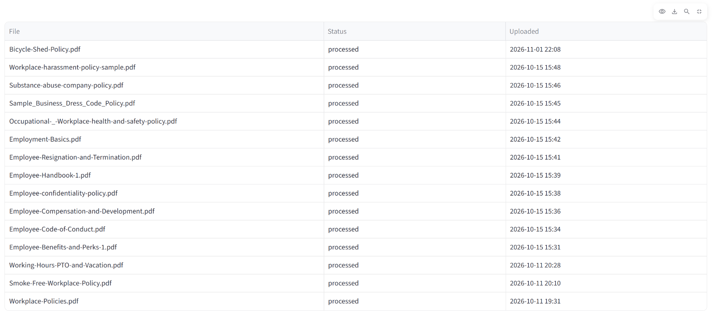
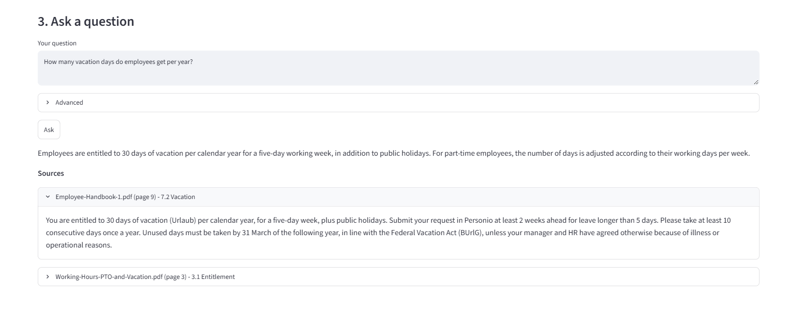
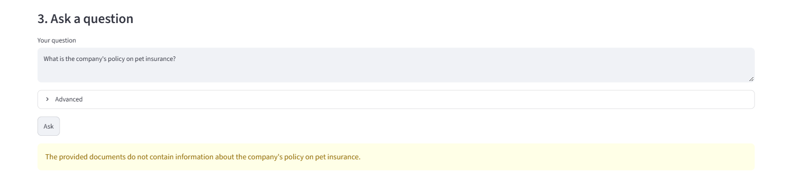
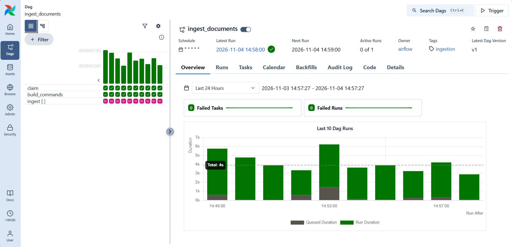
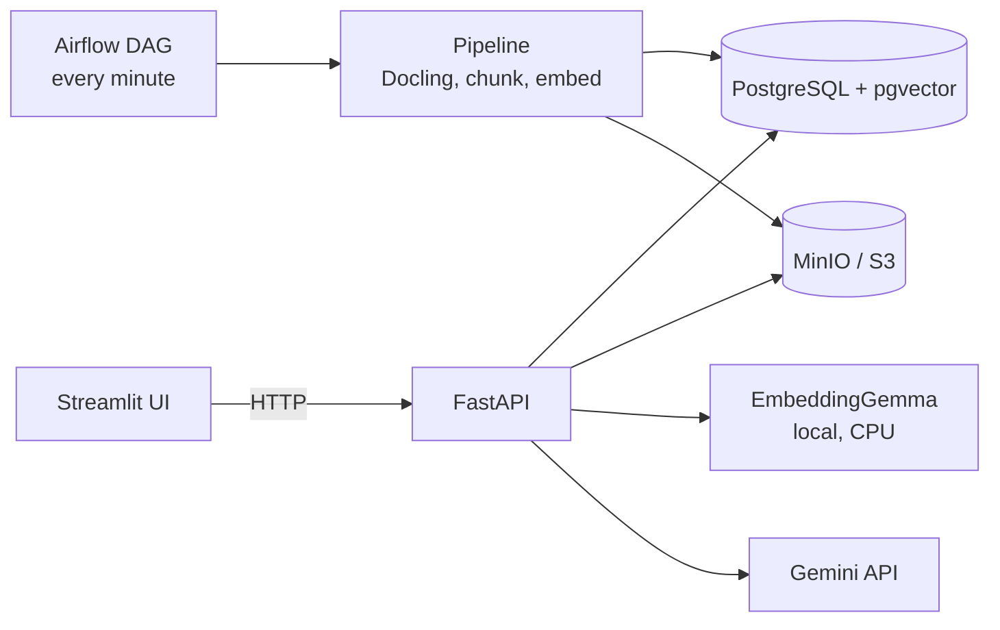

# Enterprise Document Intelligence

Ask questions about company documents and get answers that cite the file, page and section they come from. When the documents do not contain the answer, the system says so instead of guessing.

https://github.com/user-attachments/assets/86c9cb82-0b32-4eb2-afe1-a417e8c5c820

        









## What it does

- Upload a PDF (up to 20 MB). Airflow ingests it: Docling extracts the structure, HybridChunker splits it, EmbeddingGemma embeds the chunks, and PostgreSQL with pgvector stores them.
- Ask a question. The system retrieves the 8 closest chunks, sends them to Gemini, and returns an answer with citations.
- A refusal is a valid result: `found: false` and no citations.
- The demo corpus is 15 fictional PDFs (307 chunks) in `data/corpus/`.

## Tech stack

| Layer | Technology | Why |
|---|---|---|
| Document parsing | Docling, HybridChunker | Keeps pages and headings, so citations have a location |
| Embeddings | EmbeddingGemma 300M, 768 dimensions, local on CPU | No document text leaves the machine for embedding |
| Vector store | PostgreSQL with pgvector, cosine distance | One database for metadata and vectors, no extra service |
| Generation | Gemini API, structured JSON output | Answers are validated in code before use |
| API | FastAPI, Pydantic | Typed contracts, one error format |
| Orchestration | Airflow 3, LocalExecutor | Scheduling and retries, with the logic kept in plain Python |
| Storage | MinIO locally, S3 on AWS (boto3) | One storage interface for both |
| UI | Streamlit | A client of the API only, no direct database access |
| Runtime | Docker Compose, one command | Same images locally and on AWS |
| Infrastructure | Terraform, EC2, RDS PostgreSQL, S3, IAM, SSM | Recreated from code, no inbound ports on the server |
| Quality | Ruff, pytest, pre-commit, GitHub Actions | 273 tests, secret scan, CI on every push |

## Architecture



Full detail: [ARCHITECTURE.md](ARCHITECTURE.md).

## Engineering decisions

Chosen, with the reason:

| Decision | Reason | Evidence |
|---|---|---|
| Citations built by code from stored chunks | The model cannot invent a page or a file | I7, D-32 |
| Refusal from the model, plus a code check | A citation must match a retrieved chunk | D-33 |
| Airflow only schedules; logic stays in `app/` | The pipeline runs and is tested without Airflow | D-03, D-44 |
| One embedding model and one vector size | Queries and documents must live in the same space | I4 |
| Same images locally and on AWS | No second deployment path to maintain | D-53, D-55 |

Considered, not built, with the reason:

| Option | Why not |
|---|---|
| Hybrid keyword and vector search | Every expected source was already in the top 3 (48 of 48). No measured gap to fix |
| Reranking | Same reason: the retrieval measurements showed no need |
| Similarity threshold for refusal | Answerable and unanswerable questions overlap in score (0.38 to 0.76 and 0.16 to 0.66) |
| Vector index (HNSW, IVFFlat) | 307 chunks: an exact search takes milliseconds |
| Agents, fine-tuning, local LLM | No requirement in scope; a fixed pipeline is simpler and easier to evaluate |
| CloudWatch logs and alarms | Cut at the phase limit; logs are readable on the server (D-67) |

Each "not built" line is a decision to revisit only with new evidence. See [DECISIONS.md](DECISIONS.md).

## Results

Evaluation: 53 questions written for this corpus, 48 answerable and 5 that the documents cannot answer. Measured on the final corpus (E-9).

| Measure | Result |
|---|---|
| Expected source in the top 3 retrieved chunks | 48 of 48 |
| Mean reciprocal rank | 0.92 |
| Answered when the documents contain the answer | 48 of 48 |
| Refused when the documents do not contain the answer | 4 of 5 (q16 is a borderline case, judged by hand) |
| Citations include the expected source | 48 of 48 |
| Mean citation precision | 0.94 |
| Answers with one extra related citation | 7 of 48 (3 to 7 across runs) |

Limits of these numbers:

- The questions and documents are mine and fictional. This measures this system on this set; it is not a benchmark.
- Retrieval is scored by source document. Page-level matching is not scored.
- Answer correctness is judged by hand. At the first measurement, 10 of 47 answers were only partly complete (E-4).
- The extra citation varies between identical runs. Judge changes by the retrieval and refusal numbers, not by one padding count.

## Run it locally

Requirements: Docker Desktop with at least 8 GB of memory for Docker, about 25 GB of free disk, a Hugging Face account with the license for `google/embeddinggemma-300m` accepted, and a Gemini API key.

```powershell
copy .env.example .env
```

Edit `.env` and set `HF_TOKEN` and `GEMINI_API_KEY`. Then:

```powershell
docker compose up -d --build
```

The first build downloads and bakes in the models. It takes 30 to 90 minutes, depending on the disk.

| Address | What |
|---|---|
| http://localhost:8501 | UI |
| http://localhost:8000/docs | API docs |
| http://localhost:8080 | Airflow (`airflow` / `airflow`, local only) |
| http://localhost:9001 | MinIO console |

Load the corpus. A file already stored is refused with `409`, so repeating this is safe:

```powershell
Get-ChildItem data\corpus\*.pdf | ForEach-Object { curl.exe -s -F "file=@$($_.FullName);type=application/pdf" http://localhost:8000/api/v1/documents }
```

Ingestion takes about 3 to 4 minutes per document. Check the whole system end to end (about 5 minutes, 2 Gemini requests):

```powershell
uv run python -m scripts.e2e_check
```

**Verification status.** The author ran the local stack on Windows with Docker Desktop, and ran the AWS deployment end to end on the server (Phases 12 and 13). Not yet done: a second person following these steps on a clean machine.

## API

| Endpoint | Purpose |
|---|---|
| `POST /api/v1/documents` | Upload a PDF |
| `GET /api/v1/documents` | List documents, newest first |
| `GET /api/v1/documents/{id}` | One document and its status |
| `DELETE /api/v1/documents/{id}` | Delete a document, its chunks and its file |
| `POST /api/v1/search` | Retrieved chunks, without the LLM |
| `POST /api/v1/ask` | Grounded answer with citations |

Full reference: the API docs at `/docs`.

## Tests and evaluation

```powershell
.\scripts\check.ps1
```

Runs lint, format, 273 unit and integration tests, and the Terraform checks when Terraform is installed. Start the containers first, or the integration tests are skipped.

```powershell
uv run python -m scripts.evaluate --retrieval-only
```

Results go to `data/eval/runs/`, which is git-ignored.

## AWS

The same images run on one EC2 server, with RDS PostgreSQL and S3. The infrastructure is Terraform code in `infra/` (14 resources, including a $20 monthly budget). The server has no open inbound ports; access goes through an SSM tunnel.

- Built, checked end to end, and destroyed in Phase 13 (E-8).
- Nothing runs on AWS now. Building and removing it cost about $1 of credits in total (E-9).
- Rebuild steps: [ARCHITECTURE.md](ARCHITECTURE.md), section 12.3.
- Not yet verified: running `terraform apply` on a machine with no local state.

## Limitations

- **Gemini free tier.** One afternoon, 2 of 6 questions failed with a 503 "high demand" error, shown to the user as "The AI service request failed". Calls took 13 to 22 s that afternoon and about 1 s at night, on the same code. The API returns a clean 502; there is no retry yet.
- **Document parsing.** Text inside images is unreliable. Some tables lose their header row or split across chunks. Some headings are wrong, so the page number is the reliable part of a citation.
- **No authentication.** Anyone who can reach the port can upload and delete. Locally that is your own machine; on AWS the network blocks access.
- **Duplicates.** A duplicate upload is refused by file content (SHA-256). The 14 documents uploaded before that change have no stored hash, and the same text in a different file is not detected.
- **Prompt injection.** One test document with one hidden instruction is ignored by the model. That is one case, not a guarantee.
- **Resources.** One ingestion uses about 7 GB of RAM at peak. Ingest one document at a time on an 8 GB machine.
- **Logs.** One line per request with a request id; question, answer and chunk text are never logged. On AWS the logs are read in a server session.

## Documentation

- [PROJECT.md](PROJECT.md): scope and requirements
- [ARCHITECTURE.md](ARCHITECTURE.md): how the system works now
- [DECISIONS.md](DECISIONS.md): why each choice was made, with the evidence (E-1 to E-9)
- [ROADMAP.md](ROADMAP.md): plan, status and backlog
- [airflow/README.md](airflow/README.md): the Airflow image and DAG

## License

MIT. See [LICENSE](LICENSE). Copyright akaoukaou4.
