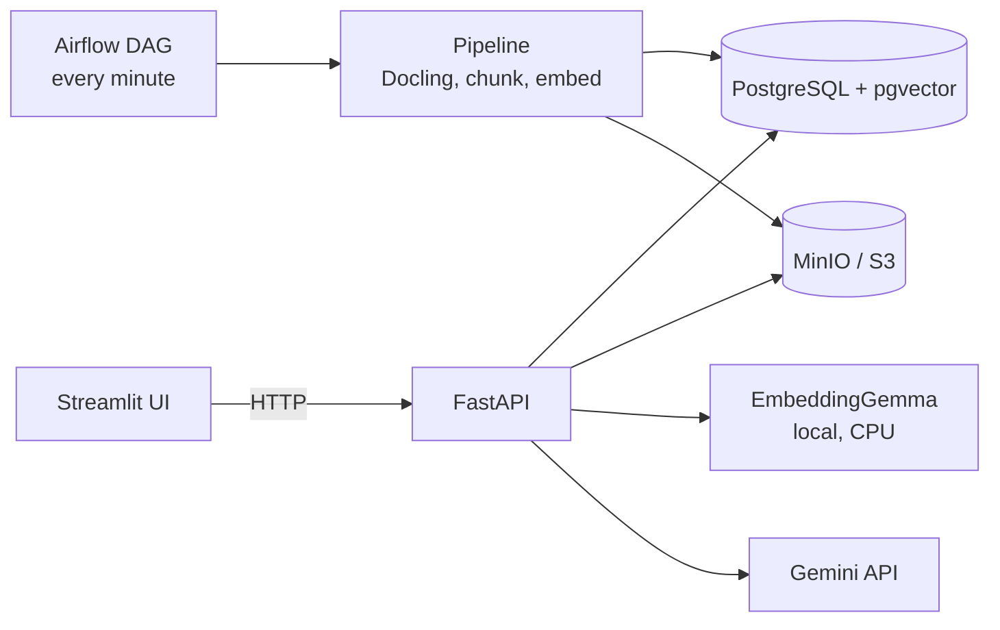

# Enterprise Document Intelligence

Ask questions about company documents and get answers that cite the file, page and section they come from. When the documents do not contain the answer, the system says so instead of guessing.

[Demo video (52 s)](docs/img/demo.mp4)


## What it does

- Upload a PDF (up to 20 MB). Airflow ingests it: Docling extracts the structure, HybridChunker splits it, EmbeddingGemma embeds the chunks, and PostgreSQL with pgvector stores them.
- Ask a question. The system retrieves the 8 closest chunks, sends them to Gemini, and returns an answer with citations.
- A refusal is a valid result: `found: false` and no citations.
- The corpus used for the demo is 15 fictional PDFs (307 chunks), committed in `data/corpus/`.

## Architecture



Design choices that matter:

- **Citations are built by code**, from stored chunks. The model returns only source numbers, so it cannot invent a page (ARCHITECTURE I7, DECISIONS D-32).
- **No similarity threshold.** Scores did not separate answerable from unanswerable questions, so refusal comes from the model and a code check (D-33, E-4, E-9).
- **Dense retrieval only.** Hybrid search and reranking were not added because the evaluation showed no need (D-07).
- **Airflow orchestrates, Python does the work.** The pipeline runs without Airflow, and tests run without it too (D-03, D-44).
- **Services and infrastructure are separate.** The same images run locally and on one AWS server (D-53, D-55).

Full architecture: [ARCHITECTURE.md](ARCHITECTURE.md). Reasons for each decision: [DECISIONS.md](DECISIONS.md).

## Results

Evaluation: 53 questions written for this corpus, 48 answerable and 5 that the documents cannot answer. Measured on the final corpus (E-9).

| Measure | Result |
|---|---|
| Expected source in the top 3 retrieved chunks | 48 of 48 |
| Mean reciprocal rank | 0.92 |
| Answered when the documents contain the answer | 48 of 48 |
| Refused when the documents do not contain the answer | 4 of 5 (q16 is a borderline case, judged by hand) |
| Citations include the expected source | 48 of 48 |
| Mean citation precision | 0.94 |
| Answers with one extra related citation | 7 of 48 (3 to 7 across runs) |

Limits of these numbers:

- The questions and documents are mine and fictional. This is a measurement of this system on this set, not a benchmark.
- Retrieval is scored by source document. Page-level matching is not scored.
- Answer correctness is judged by hand. At the first measurement, 10 of 47 answers were only partly complete (E-4).
- The extra citation varies between identical runs. Judge changes by the retrieval and refusal numbers, not by one padding count.

## Run it locally

Requirements: Docker Desktop with at least 8 GB of memory for Docker, about 25 GB of free disk, a Hugging Face account with the license for `google/embeddinggemma-300m` accepted, and a Gemini API key.

```powershell
copy .env.example .env
```

Edit `.env` and set `HF_TOKEN` and `GEMINI_API_KEY`. Then:

```powershell
docker compose up -d --build
```

The first build downloads and bakes in the models. It takes 30 to 90 minutes, depending on the disk.

| Address | What |
|---|---|
| http://localhost:8501 | UI |
| http://localhost:8000/docs | API docs |
| http://localhost:8080 | Airflow (`airflow` / `airflow`, local only) |
| http://localhost:9001 | MinIO console |

Load the corpus (a file already stored is refused with `409`, so this is safe to repeat):

```powershell
Get-ChildItem data\corpus\*.pdf | ForEach-Object { curl.exe -s -F "file=@$($_.FullName);type=application/pdf" http://localhost:8000/api/v1/documents }
```

Ingestion takes about 3 to 4 minutes per document. Check the whole system end to end (about 5 minutes, 2 Gemini requests):

```powershell
uv run python -m scripts.e2e_check
```

## API

| Endpoint | Purpose |
|---|---|
| `POST /api/v1/documents` | Upload a PDF |
| `GET /api/v1/documents` | List documents, newest first |
| `GET /api/v1/documents/{id}` | One document and its status |
| `DELETE /api/v1/documents/{id}` | Delete a document, its chunks and its file |
| `POST /api/v1/search` | Retrieved chunks, without the LLM |
| `POST /api/v1/ask` | Grounded answer with citations |

Full reference: the API docs at `/docs`.

## Tests and evaluation

```powershell
.\scripts\check.ps1
```

Runs lint, format, 273 unit and integration tests, and Terraform checks when Terraform is installed. Start the containers first, or the integration tests are skipped.

```powershell
uv run python -m scripts.evaluate --retrieval-only
```

Results are written to `data/eval/runs/`, which is git-ignored.

## AWS

The same images run on one EC2 server, with RDS PostgreSQL and S3. The infrastructure is Terraform code in `infra/` (14 resources, including a $20 monthly budget). The server has no open inbound ports; access goes through an SSM tunnel.

- Built, checked end to end, and destroyed in Phase 13 (E-8).
- Nothing runs on AWS now. Building and removing it cost about $1 of credits in total (E-9).
- Rebuild steps: [ARCHITECTURE.md](ARCHITECTURE.md), section 12.3.
- Not yet verified: applying the Terraform on a clean machine with no local state.

## Limitations

- **Gemini free tier.** On one afternoon, 2 of 6 questions failed with a 503 "high demand" error (the user saw "The AI service request failed"). Gemini took 13 to 22 s per call that afternoon and about 1 s at night, on the same code. The API returns a clean 502 with no retry yet.
- **Document parsing.** Text inside images is unreliable. Some tables lose their header row or split across chunks. Some headings are wrong, so the page number is the reliable part of a citation.
- **No authentication.** Anyone who can reach the port can upload and delete. Locally that is your own machine; on AWS the network blocks it.
- **Duplicates.** A duplicate upload is refused by file content (SHA-256). The 14 documents uploaded before that change have no stored hash, and the same text in a different file is not detected.
- **Prompt injection.** One test document with one hidden instruction is ignored by the model. That is one case, not a guarantee.
- **Resources.** One ingestion uses about 7 GB of RAM at peak. Ingest one document at a time on an 8 GB machine.
- **Logs.** Logs are one line per request with a request id, and they never contain question, answer or chunk text. On AWS they are read in a server session; there is no CloudWatch.
- **Not yet verified.** The Quick start has not been followed from a clean machine by someone else.

## Documentation

- [PROJECT.md](PROJECT.md): scope and requirements
- [ARCHITECTURE.md](ARCHITECTURE.md): how the system works now
- [DECISIONS.md](DECISIONS.md): why each choice was made, and the evidence (E-1 to E-9)
- [ROADMAP.md](ROADMAP.md): plan, status and backlog
- [airflow/README.md](airflow/README.md): the Airflow image and DAG

## License

MIT. See [LICENSE](LICENSE). Copyright akaoukaou4.
